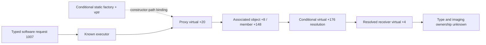

# T16 · Concrete software proxy and setting-byte boundaries

2026-10-12 · [Issue #41](https://github.com/ZakuZakuu/ep7-film-hack/issues/41). Baseline latest main **796f8bec0f695802895dacafc000c9fbf17a2373** (merged PR40).

**New, verified static architecture evidence; not an ART breakthrough.** A previously unresolved executor virtual call has a concrete constructor-path receiver and a second, explicitly qualified delegation interface. Generic settings forward a returned byte to a local notification-constant map, rather than forwarding the entire style record. Neither finding identifies an ART writer, persistent look format or pixel/preview/JPEG consumer. Four adaptive cycles completed; A and D had no eligible new code anchor, rather than fabricated experiments.

E-P7, owner-reported FW1.1. Original **111017984 bytes / SHA-256 9d1610124ad98f6edae4540182205f06c9c703d9033ef0c4f19847193f95eaeb**; decoded OE#0 **26214336 bytes / SHA-256 5dd9af164b4590c7e82f6905c919b3cc450bb58f2d5742ab2a0e3a4eb2e26190**. Original, all five zero OE residuals and decoded hash unchanged before/after. Coordinates below are **decoded #0 offsets**, never raw BIN offsets or observed RAM. Main alias60020020+ is used at independently nominated references; copied initializer61d87d60+ is confined to [2107e0,23eb30). Explicit static object622f4a58 is outside that initializer map: no firmware-image inverse or physical-memory claim is made.

## Four-cycle decision record

| Cycle / hypothesis and independent anchors | Bounded experiment / new result | Falsifier and outcome |
| --- | --- | --- |
| **A source identity**: producer301d16 and seed4c2a84 are both temporary-object facts, not independent source-entry anchors | Existing evidence audit only; zero new source windows, no repeat direct-caller/self-literal scan | No nominated creator/vptr/setter. **Blocked**, not proof no writer exists; continue B |
| **B1 receiver construction**: executor804813→804792; separate actor constructor804cde→804d28 | Actor initializer merely zeros fields: reject it as receiver binding. Getter separately creates/publishes a static receiver throughA154B4 | A generic reset is insufficient. New creation/publication relation supports B2; no ART binding |
| **B2 concrete indirect dispatch**: factory/identity-return/vptr assignment; executor consumes that vptr's+20 slot | Tight constructor and resolver windows, one selected vtable slot; a concrete proxy forwards the original request through resolved virtual+4 | No concrete downstream class/ART fields/ownership. **GO for narrower generic architecture only**, NO-GO as ART or imaging |
| **C1 UDF admission**: descriptor28fb05; pinned GNU same-encoding implementation plus manufacturer p100 | Read external implementation; run only original arithmetic fixture. Provider immediate6 multiplies; immediate255 produces-2 instead of510 | Manual operation is user-defined; GNU extension not attributed to E-P7. **No semantic admission**, no descriptor-stride invention |
| **C2 returned-byte relation**: independent setting wrappers28fe0c/28fd00; both load returned stack byte+4 before293854 | One scalar submit function and one byte consumer; input1…8 maps to3000…3007 at29141e | No typed saved payload, medium or restore. **New generic control relation**, persistence/ART remain blocked |
| **D processing ownership**: required independent typed module/frame/effect-consumer anchor | B's proxy and C's control constants supply none; zero new processing windows | No old333c50/333c72 chain reopened. **Skip and stop**, without treating request1007 or generic dispatch as ISP |

The private decision log records hypotheses, bounds, alternatives and transitions. Ten final entry-to-return windows cover **457 bytes /160 instruction rows**; no recursive callee discovery, full-image decode, resource/string scan or guessed address domain. The one directly referenced13-character format literal was checked structurally to refute a selector interpretation, not searched globally or published.

## B · Concrete object and request delegation

| New relationship / decoded coordinates | Verified fact and qualification |
| --- | --- |
| **804813→804792**, getter **[804792,8047e3)** | Reads global address61fa9968; its null initialization path callsA154B4 at8047bd and publishes returnedA0 at8047c4. Initializer word is0 at scoped source221c08, not a live pointer observation |
| Factory **[a154b4,a154da)** → constructor **[a154da,a154fe)** | Factory returns explicit static address622f4a58. Its initialization counter makes construction conditional; later object/vptr mutation remains unknown. This is not proved heap allocation |
| Base **[a1558c,a1558f)**; vptr store **a154e8** | Base is an identity-preserving RETF with matching call frame, so derived store applies to the input object. Vptr60b8b4c0 points to nominated table offsetb6b4a0; consumed slot+20 atb6b4b4 targets **a15565** |
| Proxy **[a15565,a15580)** | Loads object+8, obtains another receiver througha150a9, reloads its incoming request argument intoA1 and calls that receiver's **virtual+4 at a1557b**. CALL/RET's matching A2 save/restore supports this local argument retention under normal-return contracts; preservation through earlier executor helpers and runtime ownership remain unobserved |
| Resolver **[a150a9,a150cd)** | Reads associated object+148. If this member equals self or0, returns the member directly. Otherwise calls that member's **virtual+176**; returns a nonzero result, or original object on null result. No local store establishes cache population or lazy creation. Concrete types/targets unknown |
| Executor **804841** versus earlier request getter | D0 is overwritten by A0 returned by opaqueA2D714, whose input is currentSP+4. **Request type1007 is not proved to reach proxy D0.** A1 carries the request separately. Helper return's auxiliary meaning remains unknown |

The candidate object+8 store is a154f8, using the return of **a154f1→a09a5b**. Its destination alias additionally requires that opaque initializer to preserve A2/A3; that body/ABI has not been admitted. The later proxy+8 load is independently verified, but a complete initialization-value join is not. This is a concrete future type-binding candidate, not permission for an imaging claim. The name resolver is still text metadata, and no method ordinal was turned into a handler.

This removes one concrete constructor-path ambiguity from T7. It does not resolve every runtime instance, recover an ART selector or prove processing lives in this CPU/module.

## C · Descriptor bytes and notification constants, not a style archive

The old helper28fae4 explicitly writes a small output record: descriptor bytes+2/+3/+4/+5 go to output+0/+1/+2/+4; its caller-supplied selector goes to output+3. Subsequent opaque calls prevent unconditional propagation of initial values. This is distinct from the >=35-byte ART source and32-byte temporary effects object.

Wrappers load **current returned stack record+4** at28fe24 /28fd19 intoD0, then call293854. Function **[293854,293887)** retains that scalar and calls **[293887,293910)**. The latter's eight comparisons establish **n=1…8 → D0=2999+n, D1=1**, passed at **2938d3→29141e**. Other inputs skip that specific call; other generic operations still occur. Callees were not recursively analyzed or assigned storage semantics.

**Counterevidence:** candidate descriptors53…56 have first payload byte1…4 but last payload byte0. These are different fields; first-payload/custom-index values cannot be substituted for the returned notification byte. UDF traversal is unadmitted and intervening calls opaque, so the complete saveCustom execution, final byte values, nonvolatile storage and recall behavior remain unproved.3000…3007 are control constants, not ART/gallery IDs or ISP commands.

### Why GNU's UDF implementation does not settle E-P7

Reused [GNU sim at815d9a14](https://github.com/RTEMS/sourceware-mirror-binutils-gdb/blob/815d9a14cbbb3b81843f7566222c87fb22e7255d/sim/mn10300/mn10300.igen#L3803) treats UDFU01 as extended mulqu. Its [1997-05-05 ChangeLog](https://github.com/RTEMS/sourceware-mirror-binutils-gdb/blob/815d9a14cbbb3b81843f7566222c87fb22e7255d/sim/mn10300/ChangeLog-2021#L1534) records extended instruction support. External GPL3+ implementation is read/run, never copied into MIT tools. Manufacturer13250-040E **printed p100** explicitly says operation and flags are **user defined**. No exact E-P7 extension definition was found in these admitted sources; GNU model selection does not identify the chip.

Original fixture `mn103_udf_provider.s` checks17×6=102 and low-word overflow, then2×immediate255. Pinned GNU returns **0xfffffffe (-2)** rather than zero-extended-immediate expectation510, under all three architecture selections; controlled exit91 distinguishes this from failed earlier checks(73). This is a **provider counterexample**, not observed E-P7 behavior. UDF remains unmodeled in instruction contracts and a stop in CFG. No original code, extracted or reconstructed OEM routine was executed.

Other audited tools/methods were reused from [T14](e142-system-re-workbench.md) and [T15](e142-mn103-semantics.md): GNU2.44/GPL, scoped CHDK ad402e1/GPL2 maps, Fuji754acff/GPL3 typed-message ownership, ML142472e/GPL2 platform boundaries. No addresses/code transfer. Ghidra12.1.4 lacks admitted MN103; REA6.4.0 Cloud limitation was not retried. No heavy install or Cloud Setup change.

## Decision, gates and next decisive experiment

| Gate | T16 assessment |
| --- | --- |
| G0 | Community methods/source verified for investigation, no E-P7 custom-ART precedent |
| G1 | Exact private firmware/OE/decoded guards pass |
| G2 | **Incomplete**: source creator/+20 writer, UI/ART binding, persistence and real processing ownership still missing |
| G3 / G6 | Custom color grain, editable independently saved film looks and preview/JPEG outcomes untested |
| G4 / G5 | **NO-GO**; no modification package or accepted installation/recovery path |

**Recommendation: retain this narrower architecture result; pause generic delegation/persistence tracing without a new typed anchor.** ART remains first candidate, not replaced with manual recipes, COLOR or generic banks. Stock rendering capability does not establish custom grain, independent slots, names/icons or installation safety.

**Strongest next finite offline experiment:** identify the concrete type/registration of the object returned by a09a5b and stored at proxy+8 (writer a154f8), cross-checking the independently observed+148/+176 consumer. Require a real constructor/vptr/registration identity, verified A2/A3 preservation and a discriminating output-object relation; if it yields only another generic proxy or an unbound runtime object, stop this route rather than recursively following ordinary calls. It is a type-binding experiment, **not a processing experiment**. Even success still needs an independent ART source+20 setter/selector or effect-state consumer before pursuing rendering. No automatic next Issue/task, owner action, new old-version sample or camera access is requested.

[Selected numerical evidence](e142-art-architecture-validation.json) · [Private reproduction](../docs/22-art-architecture-private-validation.md).60 synthetic tests,0 skipped; original/five OE/decoded guards pass. Continuing private database has36 windows/2132 rows/55 curated relationships, preserves prior negatives and two loop proofs. Public content is original checks/fixture/selected facts only; no OEM bytes, assembly dumps, private project, identity or capture. One concentrated PR; await GPT review, no merge.
