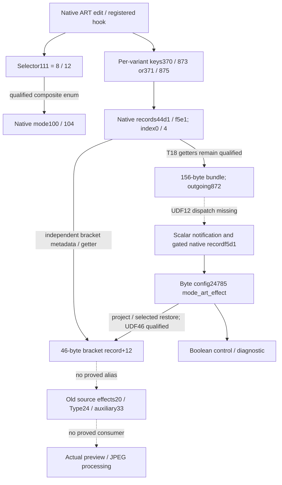

# T19 · Native ART effect records, selector representation and bracketing state

2026-10-13 · [Issue47](https://github.com/ZakuZakuu/ep7-film-hack/issues/47) · baseline **6ce9dccb6fecd7fad597a6d14b3ffee204558df6**, merged PR46. **New static parameter-source/record evidence, not a pixel pipeline or custom-ART feature.** Research checkpoint; the bounded campaign continues with adversarial/lifecycle verification.

E-P7, firmware **owner-reported1.1**. Original **111017984 bytes**, SHA256 **9d1610124ad98f6edae4540182205f06c9c703d9033ef0c4f19847193f95eaeb**; decoded OE#0 SHA256 **5dd9af164b4590c7e82f6905c919b3cc450bb58f2d5742ab2a0e3a4eb2e26190**. All five OE residuals0; original/decoded hashes unchanged. Coordinates are **decoded#0 offsets**, except explicit static values under the inherited scoped mappings. RAM contents and hardware execution were not observed. No OEM execution/modification, device operation, installer, update bypass, original-data publication or Setup change.

## Reuse decision and evidence classes

Fresh GNU2.44 [opcode source](https://github.com/RTEMS/sourceware-mirror-binutils-gdb/blob/binutils-2_44/opcodes/m10300-opc.c), SHA1e1150db856998de8366870394297e37d51db464164190e6ed0f988b44910796, GPL3+, supplied all instruction decoding; original assembler snippets nominated literal/field candidates. Existing GNU [sim815d9a14](https://github.com/RTEMS/sourceware-mirror-binutils-gdb/blob/815d9a14cbbb3b81843f7566222c87fb22e7255d/sim/mn10300/mn10300.igen#L1986), GPL3+, and manufacturer13250-040E printedpp54/100 supply limited DIV and user-defined-instruction contracts. Only original arithmetic/other fixtures run. Positive signed DIV quotient/remainder checks and a wrong-remainder73 control supplement T18's DIVU checks; no flags, faults, negative dividends, cache fidelity or E-P7 UDF admission follows.

GR Custom Tool's [pinned descriptor/lifecycle method](https://github.com/DoYitNow/gr-custom-tool/blob/549591db6ee7809fa7617c3637296ddc79b34f59/gr4_editor/slots.py), GPL2-only, remains a method reference, not copied code/addresses or independently reproduced E-P7 functionality. CHDK/ML/Fuji limitations from T14–T18 remain. Reused OE parser, GNU, SQLite and the existing finite-word-copy verifier; no ISA/decompiler framework, unlicensed Ghidra language or REA retry. A targeted public UDF search returned unrelated results and supplied no usable source; it is not absence evidence. No exact-model extension specification arrived. The new record-ID and enum joins avoid assuming UDF multiplication.

**Verified** below means reproducible physical table and decoded instruction relations. Entire execution paths remain **conditional** on valid registration/pointers, normal returns and stated opaque-call/loop assumptions. Native effect meanings, hardware outcomes and durable persistence not explicitly established are **unknown**. Text names independently corroborate code fields; they do not prove processing.

## 1 · 872 consumers: two hypotheses, then an independently grounded registry

| Test | Evidence / counterevidence | Result |
| --- | --- | --- |
| H1: a callback descriptor binds872 | Enumerate T18's exact439×60 table41178c;872/362 absent,363/873 positive controls | No dedicated hook in this table. Absence is not an unsupported-setting proof |
| H2: direct immediate872 supplies a property getter | Original GNU A0/D0/D1 load encodings, bounded64 hits/form;12/13/6 candidates, not classified code by byte match | Candidates are the known writer, log arguments, object offsets and GUI IDs. No new typed getter; cde580 is not scalar setting access |
| New discriminator: actual format registry/native key map | Lookup29a503 explicitly references runtime62248528; initializer29a4ad uses source4ac96c/count1333/stride20.872 uniquely at4b0c88 | Type byte17=1 produces classifier **2**, not1; optional enum table+8 is0. Ten byte-domain candidates cover0…9; no operator names assigned |
| Independent native ID reads | Mapping2abd1b/2abf6b explicitly uses4b6bf4,4-byte rows, keys0…1768. Original GNU full/signed literal-ID probes; two actual getter/store origins |872→native record **f5d1/index0**; reads28851a/c470b9 write **configuration+24785** as a byte |

Native getter3e951→3ef9d uses record low3 bits for width and bit8 for byte/halfword sign extension. **f5d1 is a signed byte**;0…9 remains nonnegative. Direct diagnostic13d94da/de binds+24785 to **mode_art_effect**. Comparison key362→**44c1/index0**, key363→**44c1/index1**, unsigned bytes; independent reads28852d/c470a5 put index0 at+24784, directly diagnosed as **mode_art_effect_type**. This byte is not old source Type halfword+24.

**Actual scalar consumption:** notification29141e scalar branch→290b00→2abc3d/2abc54→3ea02→conditional3eabf. The selected codec writes a byte through two pointer views (which may alias), not an image or flash block.299dcb's absent enum-map pointer skips enum normalization; it does **not** imply no native write because the notification performs storage. Gate62257b04==1 suppresses this backing-byte path; other validation/mode branches can also prevent it. Bank292230 UDF12 remains opaque: the physical bank/type table nominates290ba4, but its selection/execution is not proved.

The value held in D3 across290b00→2ac102 is preserved by that helper's actual nested CALL saving D2/D3/A2/A3.2ac102 also updates a native **word mirror**, record8b54/index=setting key, before the byte gate. Remaining scalar/pointer joins retain normal-return/valid-memory conditions; no complete processor ABI is inferred.

## 2 · Raw mode, composite selector and transient ownership

Setting111's twenty-byte descriptor4accf0 has type6: it is **composite**, unlike the identically keyed native scalar leaf. Actual147×34 group lookup2915d2 declares111 at4108ee with **three** active leaf keys111/908/973 followed by3200 sentinel.290d7b collects them using raw2abbea and zeros a64-byte local snapshot. Do not call this sixteen active controls or a complete film look.

The enum has **33 physical64-byte candidates**, data49a8dc, selectors48dda8. Selected selector8/12 map to physical ordinals17/21 at **49ad1c/49ae1c**, whose first word/native leaf111 is **100/104**.299da4 and299e5e compare the composite vector and map its index; comparison/helper and runtime-value assumptions remain. The last ordinal32 is a fallback, not necessarily an equality-tested candidate. No stock filter names or33 user slots are assigned.

Getter290d1b returns a **20-slot-shaped64-byte scratch pool** at static62245a44, ending at bytecounter62245f44. Positive DIV remainder20 and shift6 explain geometry. The counter wraps at256, and no locking/reentrancy lifetime is proved. This is transient shared ownership, not flash, caller-owned permanent data or a preset archive. Existing finite-copy proof at290dcc establishes16 words/64 bytes under the unchanged-code/nonalias contract; localSP8…71 ends before savedD2 atSP72 in the88-byte frame. It does not admit unrelated lookup loops or UDF.

Descriptor+48 now has an actual consumer: **291088/291091** in29102d. A parallel scalar path writes key-indexed words at static6225359c. Context0/1 still has **no verified RAW/capture identity**.

## 3 · Independent ART bracketing record and shared effect sources

Two current-configuration snapshot origins call builder3d1e61. Its current entry is projected by3d20e2 into a **46-byte-shaped record** at configuration+24810. Code binds byte+11←configuration24784 and byte+12←24785; selected restore3c1fc1 reverses those transfers. Getter3c0b8c has index bounds1…48. Builder caps appended entries and writes a terminator. UDF46 still blocks certifying selected-slot arithmetic;48 is **not48 named user presets**.

Independent directly used diagnostic13c6675 identifies **rec_set_exif_artbkt**, mode_bracket_pict_onoff and pict_bkt_params. The first candidate table51e250 has **31×18-byte rows**, followed by other bounded classes; it is not the thirteen-row later table. Actual3d1f16→3d2182 reads selected metadata record-ID/index fields and stores the native byte into output+12.

| Independently selected record | Native effect source | Cross-check against T18 |
| --- | --- | --- |
|51e250, raw mode100/variant1 |44d1/index0 |key370, selector8 non-2 branch |
|51e262, raw mode100/variant2 |f5e1/index0 |key873, selector8==2 branch |
|51e2bc, raw mode104/variant1 |44d1/index4 |key371, independent selector12 non-2 branch |
|51e2ce, raw mode104/variant2 |f5e1/index4 |key875, independent selector12==2 branch |

**New, different-origin join:** native ART update cases and bracketing metadata use the same per-variant effect records, with a second mode/index confirming the first. This is stronger than names or adjacent enums. It does **not** prove RAW ART BKT shares capture-time renderer/banks, runtime slot lookup, pixel handling or arbitrary effect legality. The inherited RAW callback's6836-byte-shaped result cannot contain the unshifted+24810 pool; a different view/translation or shared leaf store remains possible.

## 4 · Processing tests and lifecycle limits

- Actual effect reader3c0b64 reduces+24785 to Boolean. Its selected caller3d27c8 uses a control predicate; effect identity is lost there. No effect operator/pixel consumer.
- Record helper3d24af, called immediately after a selected metadata build, only overlays global bytes38…40. The hypothesis that it normalizes effect+12 is **refuted**.
- Restore3c162d is followed by3c1641→3c20ce. This shapes mode-dependent scalar/halfword configuration, including+3184; no old35-byte-source alias or typed preview/JPEG/ISP interface. Its bounded helper view supplied no independent processing anchor; generic tracing stops.
- Native descriptor vectorsA26FFA88/A2707A88 have no admitted file inverse/live observation. Two pointer views are not two durable copies. Mode8050 is not assigned RAW/capture semantics.
- Working word mirror: initializer2abbb9 publishes record8b54's pointer at62253598. Begin293a40 sets gate1, backs up7076 bytes and refreshes1769 shadow words; a nominated end fragment restores the mirror and clears gate0. Exact ART begin/end caller pairing, commit semantics and nonvolatile medium remain unbound. This is a configuration-lifecycle anchor, **not named saved looks**.

## Graph and product status

T18 ended at **ART settings→156-byte bundle→872/362→opaque bank dispatch**. T19 adds independently checked native identities/consumers and a shared bracketing source, while preserving that dispatch gap:

**G1 pass; G2 incomplete; G3/G6 unvalidated; G4/G5 NO-GO.** Native effect-state storage and per-variant source sharing are newly grounded. Colour grain, arbitrary combinations, independent named custom slots, import, icons/previews, complete WB/exposure recall and safe installation remain unknown/unimplemented. Record discovery alone cannot justify product/UI/patch work.

[Selected validation](e142-t19-validation.json) and [private commands/handoff](../docs/25-t19-private-validation.md) will accompany the final reconciliation. No automatic merge or follow-on task.
