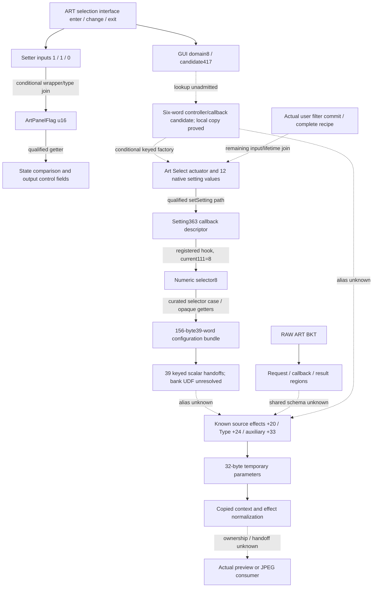

# T18 · ART state, request and candidate-record graph

2026-10-13 · [Issue45](https://github.com/ZakuZakuu/ep7-film-hack/issues/45) · main **d12070d9a662f8a1281cbd9609b566a2951daf9e** (merged PR44). **New ART-associated configuration graph: native actuator → per-selection settings → registered callbacks → 156-byte parameter bundle → scalar handoffs. No known35-byte-source or actual image-processing join.** All three tracks completed, including an evidence-supported deeper pivot; do not substitute window counts for this result.

E-P7, FW1.1 **owner-reported**. Original111017984/SHA2569d1610124ad98f6edae4540182205f06c9c703d9033ef0c4f19847193f95eaeb; decoded OE#0 SHA2565dd9af164b4590c7e82f6905c919b3cc450bb58f2d5742ab2a0e3a4eb2e26190. Original/five OE residuals/decoded hashes unchanged. Addresses below are **decoded#0 offsets**, except explicitly named static values; no observed RAM or whole-image physical map. All OEM reads/private databases stay local; no OEM code execution, modification, device operation or installation research.

## Reuse-first preflight

Freshly inspected [GNU2.44 opcode source](https://github.com/RTEMS/sourceware-mirror-binutils-gdb/blob/binutils-2_44/opcodes/m10300-opc.c) (GPL3+, external) and pinned [GR Custom Tool filter reader](https://github.com/DoYitNow/gr-custom-tool/blob/549591db6ee7809fa7617c3637296ddc79b34f59/gr4_editor/filter_reader.py)/[lifecycle implementation](https://github.com/DoYitNow/gr-custom-tool/blob/549591db6ee7809fa7617c3637296ddc79b34f59/gr4_editor/slots.py) (GPL2-only, read-only method study). One initially guessed GR path returned404; the pinned tree resolved its actual path, with no invented source. Sources/hashes are in [selected validation](e142-t18-validation.json). Reused external GNU2.44 assembler/objdump, T15 simulator **original synthetic programs only**, existing OE/SQLite/finite-copy contracts, and the [manufacturer/T16 UDF counterevidence](e142-art-architecture-sprint.md). CHDK/ML/Fuji exact-model methods and limitations remain as [audited](e142-system-re-workbench.md); none supplies an E-P7 field definition. No third-party code/addresses imported, full ISA/Ghidra language developed, REA retry or new environment install.

Only small byte-reference filters and selected-edge guards were missing. GNU assembles our original reference shapes; GNU decodes every nominated instruction. Neither a byte match nor a shared virtual offset establishes code/type. No full-image linear decode, string/JPEG/resource sweep, recursive caller framework or new alias domain.

## Six falsifiable checks and counterevidence

| Track / expected discriminator | Bounded test / negative control | New observation and decision |
| --- | --- | --- |
| **1A:** explicit readers of61fa729c may feed a selector/table | One exact u32 operation in#0; four audited direct-call forms for its two getters. Synthetic PC-start/PC-after, backward and truncation controls | Only two exact-address representations: writer74a276 and getter74a27f. Direct getter chain775b02→74a27f,7dfbeb→775b02. **No selector/table at these bodies.** Does not enumerate synthesized addresses, aliases, non-adjacent indirect calls or other components |
| **1B:** independent typed virtual uses may discriminate panel state from effect selection | Actual constructor vptr/consumed offsets, sixteen GNU-built register pairs for each of slots816/820; max64 hits/slot. Reject wrong producer/slot, intervening overwrite and mismatched target register |6 setter/7 getter pattern hits. Four reads and three scalar writes have independently nominated Shooting-return paths. ART GUI entries supply1/1, exit supplies0; two readers gate output fields on flag==1. **GO for state linkage; NO-GO as a filter/effect record** |
| **2A:** RAW request inputs might be shared effect parameters | One initializer764d17 and its two nominated callback/header field groups; compare bases/widths with existing source/temporary effects | Actor+224 context, +228 callback, +236 separate request; header has operation456/callback/self/two u16 routes. Header+12 is **not** evidence of the temporary's word effects+12. **No shared schema proved** |
| **2B:** nominated RAW callback might expose typed style data | Exact stored callbacks765243/7e9761 and two header-route helpers. Reuse relocated copy identity; no queue/callee recursion | Event1 uses a6836-byte copy argument; other events delegate saved callback/context. Operation456 is handled alongside other operations. Route normalization admits1000/1001/2000/2001/3000/3001/f000 (hex), not identified filter IDs. **Stop at request/result boundary** |
| **3A:** newly grounded ART GUI object may be the effect-source creator | ART ModeChange entry passes domain8/ID417 to e2ce88; one fixed factory/constructor and explicitly referenced data. Preserve first lookup SETLB/UDF stops | Physical candidate record is24 bytes; conditional six-word copy to constructor arguments is verified. Constructor consumes a nullable callback word, not an identified effects word. **No alias to source+20/+24/+33 or image consumer** |
| **3B:** the independently keyed component49 may own native ART parameters | Candidate417's actual component key → keyed factory/ctor; direct Art actuator label; twelve setting/cache fields → exact60-byte descriptor records. Only two selected hooks/cases8/12 and one shared bundle/dispatch slice | **New configuration-record graph.** Twelve descriptors, registered hook363→111==8→39-word bundle, field/key handoffs; not old effects source or pixels. Wrong record bases, widths, bank/type, PC convention and SCN neighbor are controls. **GO for narrower parameter research; stop generic/processing speculation** |

The former two-direction stopping rule was superseded by Issue45's three-track order. All three received bounded verification. Track3 went beyond its initial GUI boundary **because a real component key, constructor and ART-setting map supplied new independent anchors**; it did not keep following arbitrary ordinary callees. T12–T17 negatives were preserved: no301d16 direct-caller/self-literal rerun,4c2a84 seed rescan,3954fd legality claim,333c50/333c72/334780 continuation or method-ordinal handler mapping.29141e was previously an unbound notification target, not disproved ART code; this time an independently registered ART-setting record justified examining its actual+24 consumer. Other generic proxy/queue routes remain stopped.

## 1 · What ArtPanelFlag now means, and what remains conditional

The conditional singleton getter **[7daaab,7dab10)** publishes static object **622ce15c** through61fa96b4. Constructor7dab10 stamps **60acb270** (table sourceaab250). **Actual consumed** slots816/820 point to7dfb3e/7dfbab; no method ordinal is used. Constructor-path type is verified; concurrent/later mutation and runtime contents remain unobserved.

Three fresh GUI fragments use this getter and virtual816: **e3b7f8** receives D0=1 under directly referenced `SsMenuLv_ArtSelect_ModeStart_Entry`; **e3b919** receives1 under `...ModeChange_Entry`; **e3ba8d** receives0 under `...ArtSelect_Exit`. The identifying labels are **direct operand references**, not search results or proof by names alone. Their convergence with literal arguments, constructor/vtable and T17's real u16 writer **strongly supports ART-selection-interface activity/state**, rather than an ART filter ID. It does not prove this is the word's only purpose or that every legal value is Boolean.

The getter wrapper returns a zero-extended word. Bridge **[cdd277,cdd293)** ends by calling7daaab and returning its A0. Consumers **[cbff91,cbffd6)** and **[ccb308,ccb35e)** use virtual820, compare returned u16 with1, and require separate setting-query280==3 before storing output+32=157,+36=17,+192=22537. Setting280's meaning and output record type are **unknown**: do not call these filter IDs, pixel values or known source-record fields. The first getter call atccb322 has its return overwritten by the next query; it is **not** a value-dependent processing edge.

**Data-flow qualification:** setter input is held in D3 across opaque callees; full value preservation through those callees is not proved. Getter's scalar retention similarly requires normal nested return/register and state assumptions. The virtual mappings require the constructor vptr to remain current. We verify call-site values, field access and local control relationships; we do **not** claim observed writes1/0 on hardware or a fully proved whole-program alias/ABI join. Remaining adjacent-slot matches lack independent receiver binding and are not promoted to this type.

## 2 · RAW ART BKT: distinct request, callback and result regions

Initializer **[764d17,764dac)** retains callback/context inputs and writes actor+228/+224, creates a1644-size-shaped request through actor+236, and sets request+0 operation, +4 callback765243, +8 self, +12/+14 unsigned halfwords. The nominated save caller supplies456 and callback7e9761. Allocator ownership and opaque-callee preservation remain qualified. Helpers7657df/7657ad select globals61fa9070/74 and normalize route-tag values; their identities are not colour/ART enums.

Callback **[765243,7652ab)** conditionally copies a6836-byte argument into actor+252 when event1 and actor+240 permit it; otherwise it delegates through the saved+228 callback with+224 context. Selected callback **[7e9761,7e9818)** handles456 together with other operations under state2/3, then an unbound control call. Neither window reads the known effect-source fields as an independently typed record. No generic actor/task recursion followed. These numeric sizes do not identify a shared record, frame or pixel buffer.

The [exact E-P7 manual](https://my.omsystem.com/consumer/manuals/cameras/E-P7_MANUAL_EN.pdf) pp137–138 independently identifies RAW ART BKT as **post-capture JPEG-copy development**. This boundary is inherited documentary evidence, not a new renderer discovery. No capture-time shared parameters, live-preview consumer, saved custom look, persistence medium or ART renderer was established.

## 3 · Candidate GUI metadata, not another guessed filter table

ART ModeChange **e3b91b/1d/20** passes8/417 to e2ce88. That routine explicitly references static **6119fadc→source117fabc**, with field reads at0/4/8; its lookup uses **SETLB and UDFU01 immediates12/24**, still unadmitted. A physical candidate domain8 starts117a2fc, ends at the next header's pointer117cb34; that difference equals the independently stored429 count×24. Unique417 candidate is at117a56c. This establishes **physical layout consistency**, not execution of the lookup or meaning of all records.

The later local loop **e2ceee…e2cef4**, with counter−6, satisfies the existing finite-copy contract:24 bytes to current callerSP+4. CALL frame52 joins them to constructorSP+56. **This third conditional block proof does not bypass the earlier lookup/extension stops**. Constructor **[e2cb3a,e2cc33)** consumes those six words. The last word is tested as a nullable function pointer, stored at object+24 and used by CALLS; the selected417 physical candidate has0 there. **Metadata+20, output-object+24, known source effects+20 and known source Type+24 are different bases and types.** Matching offsets are not aliases.

The neighboring six-case code's direct SCN labels refute an ART interpretation:1431…1436→438…443 is **ScnSelect**, not ART. Domain8 has429 physical candidates/427 distinct IDs, not a proved ART catalogue. The initial candidate's+4 field49 became a **new independently keyed component anchor**, which justified one deeper pivot into its actual factory and native ART type. Field124 was not assigned colour/geometry semantics; dd247e and other generic constructors were not recursively explored.

### New deeper pivot: native ART setting ownership and a real configuration bundle

1. Factory **db5126** uses explicit key/function pairs at source11201d4; the actual **key49** record112031c points to **d42294**. Selected constructor **[d422d6,d4239a)** stamps vptr60fd2880. A directly referenced destructor label identifies **`Art_Select_Menu_Actuator`**. The outer GUI factory's UDF lookup remains conditional, but the keyed constructor/type/field relationships are independent code/data evidence, not a method-name ordinal.
2. Constructor reads twelve native setting keys from pairs at **fb1af4**, caches word values at **object+164…+208**. Destruction conditionally restores a selected cached value through the actual SettingController virtual0; virtual8 is the getter. Constructor7d90a7/vptr60acb0dc binds them to **7da109 /7d9529**, and the real metadata identities010202/010203 name **setSetting/getSetting**. This is a native editing/cache mechanism, **not a named preset library, nonvolatile archive, complete recipe snapshot or camera-tested cancel/commit behavior**. Later cache refreshes/helper mutations prevent claiming every restored value equals the first constructor read.
3. An explicit copied-initializer array **61fb4274→source22c514** populates ten actuator callback slots. The independently consumed object+48 slot targets d424df; its child-success path calls **d434f8**, which reads setting280 and refreshes one cache entry using the same twelve-pair table. GUI key70 pairs with native setting363; **no unconditional GUI70→ART8 translation is claimed**. The destructor's selected-token quotient is compared with setting keys, not automatically with native filter IDs. Manufacturer13250-040E p55 plus pinned GNU sim validate only **MDR=0/divisor1000/nonnegative31-bit quotient/remainder** using original137042/0/0x7fffffff fixtures and a wrong-expectation73 control. No general DIVU flags/exception or E-P7 UDF admission follows.
4. The getter reaches a keyed value/optional-callback path. A single new exact registry-base operation found its initializer **[2916d7,29172c)**: static source **41178c**, **439 records, stride60**, and a64-value hash index at static62245f48. Lookup29172c traverses runtime nodes; initialization/cache-loop semantics remain qualified and no live nodes were read. **All twelve actuator keys match unique physical callback descriptors.** Key280 is absent from this callback table but has a generic getter/fallback path; absence is not an unsupported-feature finding.
5. Notification29141e explicitly consumes **descriptor+24**. Selected setting363's record **414900** points to **295ce1**; that hook reads setting111, tests8 and calls **2988f6** with context0. Setting364's independent hook tests12. A +48 candidate supplies context1, but its exact dispatcher and RAW/capture meaning remain unbound. These contexts must not be labelled live-view/RAW banks.
6. Caller2988fb supplies context and the selected value to **297b51**. Its bounded0…65 code-pointer table at440438 has66 valid in-window targets; examined cases **8→297dfb** and **12→297e8a** read settings363/364. The common tail writes **39 distinct words, offsets0…152**, producing a **156-byte configuration bundle**.2988f6 supplies the same39 words as keyed scalar arguments to292230. In the selected slice, **setting363→bundle+32→outgoing key362**; one of370/873→bundle+76→outgoing key872. These are numeric code relationships, not assigned stock filter names, grain IDs or colour coefficients.

The output buffer starts at current callerSP+4 and ends before its saved-D2 slotSP+160; CALL/RET frames164 and172 are matched. Values and runtime registration depend on normal nested returns, intact frames, nonaliasing/valid buffers and opaque-callee preservation. Producer entry CFG still stops at indirect selector jumps; the guarded table/case relations are **curated static evidence**, not automatic complete CFG/SSA. The exact new builder-target probe found only2988fb in#0's four direct-call forms: no direct RAW link, **not proof no indirect/shared route exists**.

**Actual boundary:**292217/292230 use bank-index **UDFU01 12** and indirect target selection. This instruction remains unadmitted on E-P7. We verify the record geometry, selected case writes and forwarded key/value arguments; we do **not** prove all returned values, actual target execution, pixel processing, or that the39 fields are freely writable camera controls. General getters/store/classification/processing callees beyond the selected typed slice were not recursively explored.

| Distinct record/base | Verified field meaning / missing relation |
| --- | --- |
| Old source≥35 bytes | effects word+20, Type halfword+24, auxiliary byte+33; owner/writer still unknown |
| New60-byte setting descriptor | key halfword+0, optional value callback+20, consumed hook+24, parallel target+48; **not old source+20** |
| New156-byte configuration bundle |39 word fields; selected+32→key362,+76→key872; **no alias to old source or pixel buffer** |
| Native ART actuator |220-size-shaped creation,12 cached values at+164; editing lifecycle, **not persistence/import** |

## Data-flow graph and decision

Solid arrows below are local static relations; labelled conditional arrows need runtime type/register/state assumptions. Dotted edges are **missing**, not inferred functionality. The lower effects conversion/normalizer is inherited T5/T10/T11/T15 evidence, explicitly excluded from T18 novelty.

**T17→T18 novelty:** ART GUI/state sites and consumers; RAW request/callback boundaries; the actual ART actuator/cache, native setting API bindings, twelve per-key descriptors and selected update hooks, selector-linked156-byte bundle and matching39 handoffs. A local24-byte copy proof, directly disconfirmed SCN neighbor and limited division arithmetic support those findings. **Not novelty:** old effects conversion/normalizer, old32-byte copies, hashes, stock rendering capability or increased window count.

**G1 passes; G2 incomplete; G3/G6 untested; G4/G5 NO-GO.** No source-effect writer, accepted colour grain, shared capture/RAW style schema, actual processor ownership, named custom-entry persistence or safe installation proved. This is evidence insufficiency, not proof those capabilities are technically impossible.

**Recommendation: continue only a focused parameter-to-consumer question using the new graph; pause generic tracing and all UI/patch/install engineering.** Unlike the initial GUI/request results, Track3 now supplies independent native parameter anchors. The single strongest next discriminator is whether **one selected outgoing key362 or872 has a typed consumer that writes old source+18/+20 or enters an independently identified image-side parameter interface**. Require real per-key descriptor/read provenance and an address/lifetime join; do not sweep all39 keys or reopen333c50/333c72. Obtain independent exact-model UDF/addressing evidence or validated registration/state definitions where needed; without it, stop at the bank dispatch boundary. A lawful same-model driver/interface definition or separately authorized safe passive record observation could supply missing ownership/lifetime, but no device observer/vendor contact is asserted/requested now. Configuration state cannot substitute for preview/JPEG proof.

70 synthetic tests/0 skipped; original GNU register-pair/division fixtures and wrong-owner/slot/scalar/width/base/type/PC controls pass. Private project preserves prior evidence/negatives, adds60+74 guards and one conditional copy proof; **94 windows/5795 rows/4706CFG/28 stops/82 curated edges/3 local-copy proofs are reproduction counts, not whole-program coverage or breakthroughs**. Candidate GUI factory/registry lookup loops and indirect selector reachability remain explicit stops. Cloud Setup unchanged. [Private reproduction/handoff](../docs/24-t18-private-validation.md). One focused PR, await GPT review; no merge or automatic next sprint.
