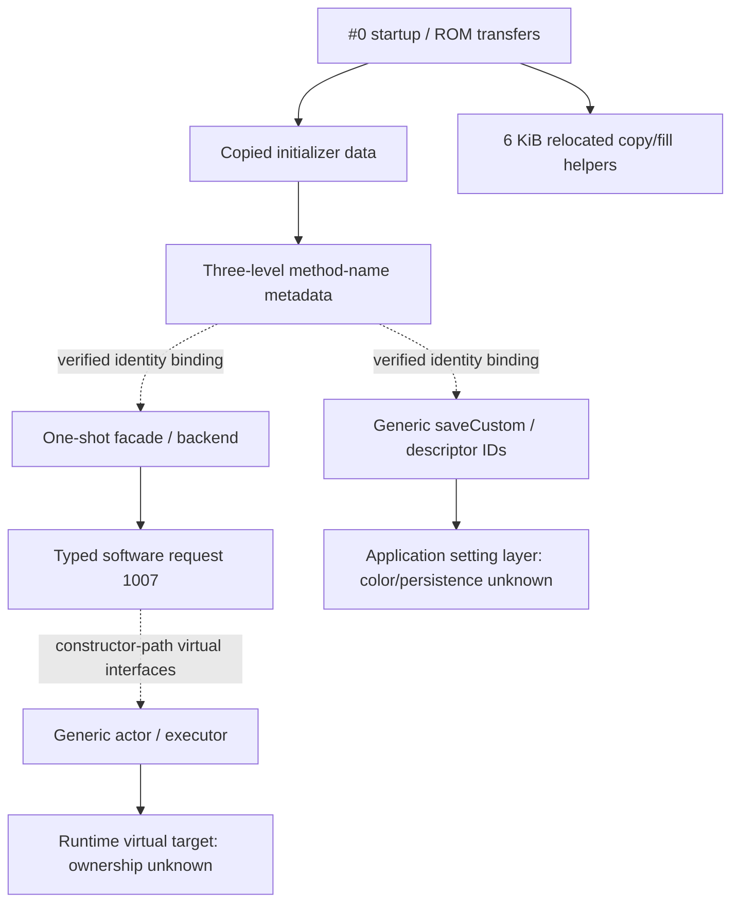

# T7 · Relocated data, runtime helpers and application-control boundaries

2026-10-12 · [Issue #25](https://github.com/ZakuZakuu/ep7-film-hack/issues/25) · [updated autonomous protocol](https://github.com/ZakuZakuu/ep7-film-hack/issues/25#issuecomment-6116290139) · latest main **`710ddf0c8d0db6c9f1169c9fd2ab63354aa61114`**, including merged PR #24. **E-P7, owner-reported1.1**, private original **111017984 bytes / SHA-256 `9d1610124ad98f6edae4540182205f06c9c703d9033ef0c4f19847193f95eaeb`**, decoded #0 **`5dd9af164b4590c7e82f6905c919b3cc450bb58f2d5742ab2a0e3a4eb2e26190`**. Fresh guards before/after; five OE residuals zero. Existing private sample/tool reused; no download, serial use or camera communication in T7.

**New architecture evidence:** startup-backed data relocation explains a previously unresolved method-name table; a separate 6-KiB runtime-helper relocation resolves the former external copy/fill targets. A verified name resolver links two real operation wrappers to **one-shot capture requests** and **generic custom-setting control**. These are credible orientation and software-control boundaries, **not an image renderer or an import mechanism**. No PictureMode chain continuation, complete section map, pixel/ISP/JPEG routine, native COLOR coefficient record or external profile ingress was established. **G2 remains incomplete; G4/G5 NO-GO.**

**Decision: retain this map, pivot toward independent processor/driver or version-specific processing evidence, and pause further firmware-static traversal until that evidence exists.** Do not automatically create another next-callee task. Stock COLOR measurement is optional G3 research, not required owner labor or completion of automatic import/live-view/SOOC JPEG. One integrated PR; no importer, patcher, emulator or new RE framework.

## Four adaptive cycles and their falsifiers

The owner update superseded the original two-lead budget. Four different finite hypotheses were selected from actual new evidence, with a private decision log and restartable handoff. GNU2.44 and existing OE/reference/window helpers were reused; [tool provenance/known Ghidra limitation](../docs/13-executable-private-validation.md) applies. No third-party source/address transfer. Neither names nor large call counts were sufficient to promote an imaging lead.

| Cycle | Grounded hypothesis and experiment | Result / discriminating counterevidence |
| --- | --- | --- |
| **H1 · Startup/storage map** | Known entry0xd9 has explicit ROM-source/destination/length calls and a subsequent word-copy loop; inspect those transfers and two selected helper destinations | **New, strong static relocation support.** Storage/page-transfer operations and generic memory primitives are distinguished from imaging; unknown special-op arithmetic and physical/cache attributes remain unknown |
| **H2 · Moved metadata and code references** | H1's initializer span contains T4's name array. Test the moved root and its actual GNU literal/three-level consumer, then selected valid identities | **New verified lookup structure and code binding.** Old ROM-linear root and +32-shift root have zero references; table returns strings, not function pointers. Invalid IDs and unrelated instruction-byte hits rejected |
| **H3 · Independent capture operation** | A valid metadata identity maps an entry-derived one-shot wrapper to its backend; examine the typed request, explicit constructor-path vtables and submission boundary | **Capture-control request type1007 established.** The route ends in a runtime executor's virtual+20 call; no pixel buffer, color record or ISP semantics. Does not inherit meaning from the old PictureMode chain |
| **H4 · Native setting/save route** | A different valid identity maps saveCustom to an integer index, descriptor and setting-layer calls | **Generic custom-setting path established.** Indices0…3 become IDs53…56; not COLOR1–4. Unsupported `udfu01 6`, absent color attribution/persistence format/ingress stop the route |

All coordinates are **decoded #0 payload offsets** unless explicitly an address candidate. OE transport lane permutation prevents treating `encoded_payload_start + decoded_offset` as a byte-for-byte raw-file address. Address views below are **static hypotheses corroborated at nominated sites**, not observed camera memory.

## H1 · Separate ROM, initialized data and relocated helpers

Entry **`[0xd9,0x37c)`** calls **0x142e** six times, with ROM-like source, destination and byte count. The source-image relation uses the OE header candidate0x406a0000 plus32-byte header. Lengths use startup-initialized endpoint constants; they are **not runtime snapshots**, and unobserved mutation by callees is not excluded.

| Call / source-image span | Source address candidate | Destination from code / initialized length | Consequence |
| --- | --- | --- | --- |
| **0x1d9**, `[0xffe0,0xb07e0)` | 0x406b0000 | 0xa0030000 /0xa0800 | Contains known trap/control anchors, not entirely proven executable |
| **0x1f6**, `[0x2107e0,0x23eb30)` | 0x408b0800 | 0xa1f98540 /0x2e350 | Contains the relocated metadata/setting initializer data investigated here |
| **0x213**, `[0x2507e0,0x2508a4)` | 0x408f0800 | 0xa1fd8540 /0xc4 | Typed initializer span; contents/role not promoted |
| **0x230**, `[0x2587e0,0x2587e4)`; **0x24d**, `[0x25c7e0,0x25c7e4)` | 0x408f8800 /0x408fc800 | 0xa1fe0540 /0xa1fe4540, four bytes each | Small initializer spans, not additional program modules |
| **0x261**, `[0x141c9e0,0x141e1e0)` | 0x41abca00 | 0xa143ca00 /0x1800 | Staged source for the explicit helper relocation |

Transfer **`[0x142e,0x1601)`** has independently referenced short labels ROM/destination/size and alignment/chunk arithmetic; its selected callee **`[0xb87,0xcbe)`** uses page index shift11, 2048-byte progress, groups of64 and controller-shaped fixed-address reads/writes (e.g.0x98d01800/+4). Together these strongly support **ROM/page-transfer control**, not a particular NAND device, identified SoC register or ISP. The local copier **`[0x12d3,0x135e)`** has byte/halfword/word copy loops. No new block was needed.

At **0x277…0x28e**, the startup loop copies **1536 words =0x1800 bytes** from0xa143ca00 to **0x47000800**. The candidate execution mapping is therefore:

`helper_address = 0x47000800 + (decoded_offset - 0x141c9e0)`, only in that0x1800-byte span.

| Previously external address | New source/body evidence | Role and limits |
| --- | --- | --- |
| **0x47001052** → **`[0x141d232,0x141d33e)`** | Dest/source/length arguments, alignment and forward byte/word load/store loops, original destination returned | **memcpy-like generic copy, strong static semantic inference**, not imaging. Explains T4's formerly unresolved copy target |
| **0x4700115e** → **`[0x141d33e,0x141d3b5)`** | Count check, repeated byte expanded to a word, aligned and tail stores | **memset-like generic fill, strong static inference**, not color coefficients or a DSP operator |

The old main-code inverse mapping places these calls outside #0; that was a real mapping gap, not proof the bytes were absent. An OE storage-address interval overlapping0x4700… would also be insufficient to assign the helper to another block. We did **not** reopen #1/#2/#3/#4 to guess a component. Hardware loops remain manually inspected; `walk()` does not emulate them or establish complete helper execution.

## H2 · A real method-name hierarchy, not a handler registry

For the large initializer, a second address view **0x61f98540** differs from the code's0xa1f98540 by0x40000000. The view is supported by multiple pointer levels and a real code consumer. **Cacheability, physical aliases and chip attributes unknown.** Use only the bounded translation:

`metadata_address = 0x61f98540 + (decoded_offset - 0x2107e0)`, effective base **0x61d87d60**, only in `[0x2107e0,0x23eb30)`.

This recovers the old **1525-word name-pointer array `[0x21f8a4,0x221078)`**, a **74-word group vector `[0x221078,0x2211a0)`** and a **six-word root `[0x2211a0,0x2211b8)`**. Root address **0x61fa8f00** is confirmed at MOV **0x75069f**, encoded word **0x7506a1**, using the existing guarded reference tool. Under the old ROM-linear root0x602411c0, or moved root+32, exact hits are **zero**. This is independent of string-name interpretation.

Consumer **`[0x75068f,0x7506c4)`**, **22 reachable instructions /return0x7506c1**, extracts three1-based index bytes from low24bits, dereferences bank→group→method and returns a **string pointer**. It neither calls that pointer nor returns a handler address. Group order is nonmonotonic, so “next group in table” cannot safely define every method extent.

| Bank / group-pointer count | Orientation from referenced names | Confidence |
| --- | --- | --- |
| 1 /21 | Camera/common controls, settings, display/system functions | **verified metadata structure**, responsibility inferred from names; not a code-module boundary |
| 2 /4 | Shooting and related operations | Metadata plus independently validated one-shot code binding below |
| 3 /37 | Playback/edit operations | Name-based orientation only; no rendering attribution |
| 4 /4 | Adjustment/maintenance entries | Metadata only; no service-mode investigation or permission |
| 5 /7 | Device link/Wi-Fi/Bluetooth/related controls | Metadata only; not external native-profile ingress |
| 6 /1 | Guide entries | Metadata only |

An exact-target direct-call prefilter for the resolver found **2258 raw candidates** in `[0x74e534,0x7e2516]`; **only four80-byte boundary contexts** were screened before the nominated operation bindings. This is **not 2258 functions**, a complete call graph or a proved executable interval. Forced decoding of the root's48bytes yields30 instruction lines,22 clears, no data directives: **decodability is not code**. Known four-byte stub padding similarly decodes as four clears.

Rejected identity controls: the prior producer diagnostic number **0x39020003** has class byte0 and is invalid for this1-based lookup; do not translate it to a method. A valid getPictureModeDialState metadata identity had no exact/low24 operand match in the nominated wrapper search range; no getter implementation claimed. Two low24 changePicMode candidates decoded as unrelated immediate258 instructions, not the expected identity. Labels/catalog availability do **not** prove compiled or runtime-enabled E-P7 functionality.

## H3 · One-shot capture reaches a software request boundary

Identity **0x020165 =bank2/group1/method101** resolves to short label **`Shooting::oneShotTakingPicture`**. Entry **`[0x7dcf56,0x7dcfb7)`** actually supplies this identity to the verified resolver and calls backend **0x7dcf96→0x77138b**. A separate callback entry **`[0x7a5420,0x7a5456)`** uses the same identity after a virtual slot332 invocation; that callback's target was not inferred from a method ordinal.

Backend **`[0x77138b,0x77144a)`** allocates a32-byte request-shaped object, initializes it through **0x77140b→0x7554e7**, and submits it at **0x771414→0x78abdc**. Constructor **`[0x7554e7,0x7554fe)`** writes a vptr and halfword **1007** at object+4. Its explicit vtable+12 points to **`[0x748450,0x748457)`**, which reads that field. These independent constructor/getter/submit references establish a **typed one-shot software request**, not an invented ISP opcode.

The submit-context constructor **0x78ab0b** assigns a vptr whose+36 slot points to actor locator **0x78adaa**. The constructor path there assigns actor vptr at **0x804ccd**, whose+164 slot points to **0x78b3a5**. Its body reads the request type via the same virtual getter, stores it at **actor+128**, prepares notification/wait-shaped state and calls **0x78b41b→0x804812**. This final executor forwards the request via **another runtime object's virtual+20 slot**. **Stop here.** The initial singleton pointer is zero in the update initializer (mapped source0x2214bc); no live heap/bindings were observed. Constructor-path virtual targets are conditional, not a claim every runtime instance has that vptr.

There is no identified framebuffer, color coefficient operation, physical processor transport, ISP register meaning or preview/JPEG consumer. Result buffers/status and timeouts are not image-processing proof. The named capture operation and typed tag supply a stronger **application-control/actor boundary**, while delegated ownership remains unknown.

## H4 · Native custom settings still do not identify COLOR profiles

Identity **0x010212 =bank1/group2/method18** resolves to **`SettingController::saveCustom`** and is used by entry **`[0x7d9f4f,0x7d9fc9)`**. It preserves an integer argument, obtains an object+4 pointer and calls **0x7d9fa0→0x807330**. Mapper **`[0x807996,0x8079ba)`** converts indices0/1/2/3 to **53/54/55/56**, rejects other values as0. Backend calls0x28fe0c and0x28fd00, which supply different selector bytes to descriptor helper0x28fae4.

That helper reads u16 identifier and byte fields+2/+3/+4/+5 from data at candidate **0x61f9eb6c** (source0x216e0c). A bounded **six-byte data-record hypothesis** has24 entries followed by zero at0x216e9c; selected IDs53…56 have first payload byte1…4. It fits the typed accesses independently, but **`udfu01 6` at0x28fb05 has unsupported semantics**. No executed multiplication/stride or complete lookup correctness is claimed. No color-field meaning, actual persistence format/medium or external import is proved by the save-like label. Four generic custom indices are **not COLOR1–4 evidence**.

The names-ID, request tag1007, settings IDs53…56 and old PictureMode composite key are **different identity spaces**. Nothing here maps one to another automatically. Internal setters/saves do not imply a callable USB/Wi-Fi upload endpoint. T5's official/OI.Share ingress exclusions remain; they were not rescanned or repackaged as a new capability.

## Orientation map and unresolved subsystem hypotheses

The [selected numeric index](e142-system-boundary-map.json) records entry-derived windows, nominated direct calls and **conditional** virtual evidence; [private reproduction](../docs/16-system-map-private-validation.md) validates it. It is a small curated index, not a complete linker/section/function database. Code/data/padding distinctions rely on startup geometry **and** typed pointer consumers/callers, with wrong-address/data-decode controls.

| Still-falsifiable subsystem hypothesis | Evidence needed to resolve it |
| --- | --- |
| A worker reached through the actor interface ultimately handles image processing in MN103 code | Independently identified worker/driver ABI, meaningful frame/parameter fields and actual consumer operations; a call/vptr alone is insufficient |
| The actor delegates processing to another processor/component | A documented transfer interface or matched model-specific driver; no current edge points to #2 ARM or #3, so neither is called the imaging firmware |
| Rich/native COLOR state is represented by the generic setting layer | Independent COLOR selector/field semantics and a rendering consumer, plus external ingress if import is the goal; generic custom slots and metadata names do not establish this |

## Decision, cost/value and restart prerequisites

This task **substantially improves address attribution and control-layer orientation**, but **G2 gains no established custom-look parameter→actual preview/JPEG consumer or import route**. We still lack COLOR slot binding, rich color representation, processing ownership and ingress. GNU's unassigned special instructions and runtime-created polymorphic objects limit semantic reconstruction. These are evidence/tool/runtime gaps, not proof an inaccessible ISP or all custom looks are technically impossible. No blind whole-image decode, guessed ISA, source-identifier percentages or algorithm development follows.

- **Pause firmware-static traversal now.** Continuing through the remaining generic virtual calls without independent ownership evidence is high cost with uncertain product value. No automatic T8 next-callee task.
- **Highest-value independent restart:** an exact-model/processor-relevant public driver/BSP/interface source, or a legally available version comparison with a specific image/color-processing change. Validate model/version/license first, then require a driver operation/field/frame meaning that discriminates rendering from the storage/control domains mapped here. A related model or shared TruePic brand alone is insufficient. Old firmware is optional, not a required missing prerequisite; no new OEM image was acquired here.
- **If that source is unavailable, keep the project paused.** A sanctioned runtime binding/ABI could also remove the executor gap, but no safe device-access mechanism is verified or authorized. Do not request speculative debug/camera probes. Stock COLOR measurement remains an optional bounded G3 value test from T6; it does not complete import or justify firmware modification.

Handoff/re-entry: retain the index/procedure and input hashes; recheck latest main and the owner protocol. Revalidate the original sample and piecewise address views before using any identifier. Resume only against the independent evidence above; do not treat this map as authorization to extend all callees or mutate firmware. Private internal decision log/transcripts are not public deliverables.

Validation: **39 existing synthetic tests /0 skipped**, real GNU synthetic call/return control, guarded moved-root reference CLI, index/countercontrol reproduction and before/after whole/OE/decoded hashes passed. CI checks tooling only. Public artifacts are original prose, selected numeric metadata and reproduction snippets; no complete method catalog, original firmware, proprietary disassembly/XML/graphics, private identifier or third-party source. PR awaits review, no automatic merge; no writes, repackaging, device session or promised background execution.
